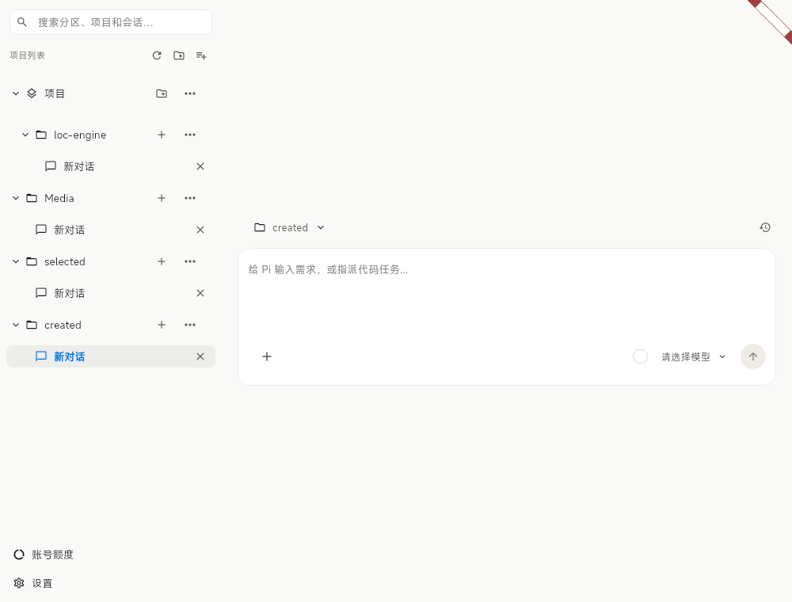
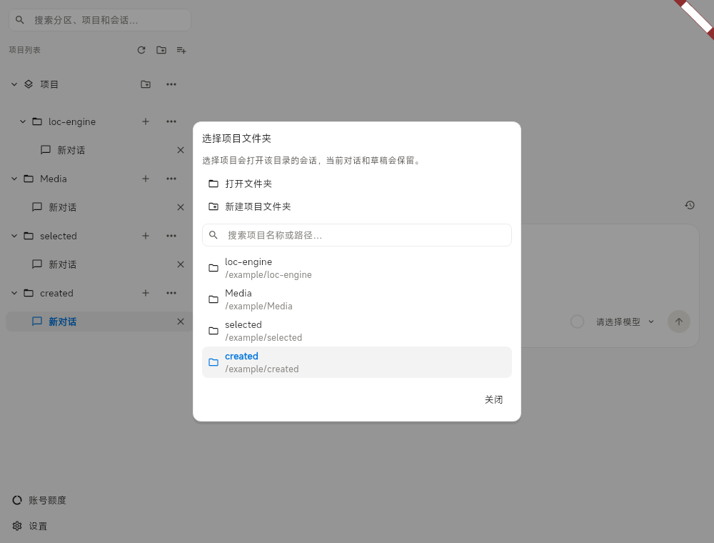

# 用分区归类项目，用左侧栏选择会话

分区是 GUI 中的分组，例如“工作”“个人”，没有磁盘路径。项目对应真实文件夹，只显示一次。**左侧只显示分区、项目与会话；文件树由右侧文件面板负责**，左侧不会再列出 `.agents`、`src`、`README.md` 等磁盘内容。

```text
工作
  frontend
    页面调整
    组件重构
个人
  Media
    图片整理
```

项目的主目录、已登记子目录和 Worktree 会话统一显示在该项目下，悬停会话可查看所属目录。不同会话保留各自的工作路径，不会为了合并显示而改变 cwd。



## 分区与会话操作

- 标题栏始终提供添加项目、新建分区按钮；分区菜单提供重命名、上移、下移、删除。自建分区的名称、顺序与折叠状态跨重启保存。
- 分区旁文件夹加号添加项目；项目菜单的“移动到分区”只改变归类，不移动文件、不停止会话。
- “未分区”没有项目时自动隐藏。有项目时可通过其菜单删除分组标题；项目直接显示在列表根部，文件与会话保留，隐藏选择跨重启保存。
- 删除自建分区后，项目成为未分区项目。如果默认分组标题已被移除，项目直接显示在列表根部，不会强行恢复“未分区”。
- 项目旁 `+` 在项目主目录创建会话；标签栏 `+` 沿用当前文档所属目录。点击会话打开对应标签，关闭标签沿用现有运行状态 / 草稿确认。
- 项目菜单中的“新建 Worktree”和“管理 Worktree”保留 Git 隔离能力。管理窗口显示真实路径，支持打开该目录的会话或按原检查流程移除 Worktree。
- 左侧刷新仅刷新项目快照及展开项目的会话历史；文件刷新仍由右侧负责。搜索只匹配分区、项目和会话标题，不扫描文件系统。

## 从聊天中的目录名切换项目

空对话输入框上方、已有对话顶部的文件夹名称都是可点击按钮，带下拉箭头。弹窗支持：

1. 搜索并选择已登记项目：定位该目录已打开的会话，没有时新建会话。
2. 打开文件夹：调用系统文件夹选择器，登记所选目录并打开会话。取消选择不改变当前状态。
3. 新建项目文件夹：选择存放位置、填写名称、查看目标路径，点击“创建并打开”。只创建一个空子目录，不初始化 Git，不覆盖已有文件夹。

选择其他项目保留原会话、草稿、附件与后台进程，不替换正在运行的 Pi 的 cwd。新目录默认沿用当前项目分区；选择已登记目录不隐式改变其分区。操作失败保留弹窗并显示错误；创建后打开失败时目录保留，可通过“打开文件夹”再次选择。



## 数据与迁移

数据仍由 Node 管理器串行保存到 GUI 自有 `workspaces.json`，不修改 Pi 私有历史文件。位置与覆盖变量见 [工作区与会话](workspaces_sessions.md)。

```json
{
  "catalog": {
    "version": 2,
    "unassignedHidden": true,
    "sections": [{"id": "section-work", "name": "工作", "collapsed": false}],
    "projects": [{
      "path": "/home/me/frontend", "name": "frontend",
      "folders": ["/home/me/frontend/src"], "sectionId": "section-work"
    }],
    "names": {}
  }
}
```

分区使用独立 ID，重名分区不会合并。`sectionId: null` 表示未归类项目，`unassignedHidden` 只控制其分组标题。版本 1 的项目路径、Worktree 信息保留并迁入未分区；无效分区引用同样归入未分区。缺少隐藏字段按 false 处理；空项目列表保持为空。旧版 GUI 不识别 catalog 版本 2，回退前应备份 GUI 自有配置。

子目录会话打开后将 cwd 记入项目 `folders`，关闭通道后仍可发现其历史；无需遍历磁盘目录。项目工作区按系统路径规则去重并保留原始顺序，Windows 下分隔符或大小写不同的同一目录只显示一份会话列表。现有缓存、历史去重与迟到响应隔离规则保持不变。

## RPC 与架构

全部管理命令经 `control` 通道的强类型 `PiCatalogService`，复用未确认写请求屏障，超时不自动重发。分区 / 项目管理写操作串行执行；保存失败由 `persistenceWarning` 提示。

| 命令 | 参数 | 行为 |
| --- | --- | --- |
| `gui_create_section` | `sectionId`, `name` | 同 ID 创建幂等 |
| `gui_update_section` | `sectionId`, `name?`, `collapsed?`, `direction?` | 重命名、折叠、上下排序 |
| `gui_delete_section` | `sectionId` | 项目移到未分区 |
| `gui_hide_unassigned` | 无 | 移除默认标题，不移除项目 |
| `gui_move_project` | `path`, `sectionId` | null 表示未分区 |
| `gui_add_project` | `path`, `sectionId?` | 注册现有目录，保持 Git 项目去重 |
| `gui_create_project` | `parent`, `name`, `sectionId?` | 复用 `WorkspaceService.createWorkspace` 创建空目录并注册 |
| `gui_get_catalog` | 无 | 返回分区、隐藏偏好与项目快照 |

写后沿用 `gui_catalog_changed` 刷新。会话仍使用 `gui_workspace_history`、`gui_open_channel`；文件浏览 RPC 只供右侧使用。`knownWorkspace()` 解析真实路径并检查最近的已登记根目录；移除项目撤销子目录归属，子目录会话同样阻止移除父 Worktree。历史读取后重查目录和锁，同一历史的并发打开保持单一所有权。

关键路径：

- `assets/backend/workspace_manager.mjs`：迁移、保存、管理 RPC、目录归属和子目录登记。
- `lib/core/rpc/pi_catalog_types.dart`、`pi_rpc_client.dart`：强类型模型、API 与写请求屏障。
- `lib/ui/features/home/controllers/workbench_controller.dart`：项目会话归属、历史缓存、选择 / 创建项目。
- `lib/ui/features/home/widgets/workbench_sidebar.dart`：只显示会话的项目导航。
- `lib/ui/features/home/widgets/project_picker_dialog.dart`：选择现有项目、系统目录选择、创建表单。
- `lib/ui/features/home/widgets/home_chat_panel.dart`、`views/home_view.dart`：两处聊天目录按钮与弹窗连接。
- `lib/l10n/app_zh.arb`、`app_en.arb`：所有新增文案。界面复用现有树节点、菜单、弹窗、输入框、按钮、主题和动效。

## 验证

```bash
flutter analyze --no-pub
flutter test --no-pub
node --test test/workspace_manager.test.mjs test/workspace_backend.test.mjs test/workspace_browser_backend.test.mjs
node tool/check_parallel_rpc.mjs
flutter build linux --release -t lib/main.dart
```

静态分析通过，173 项 Flutter 测试和 29 项工作区 Node 测试通过。核心回归验证左侧不读文件、保留子目录历史、同一目录的路径别名去重、隐藏默认标题的持久化、创建目录的名称 / 重复路径检查，以及现有目录归属和并发保护。真实 Pi RPC 探针验证新建目录与会话 cwd，不请求模型。

临时隔离界面走查直接点击实际聊天目录按钮，覆盖切换项目保留草稿、取消选择、选择现有目录、新建目录、移除默认标题后保留项目和会话，280px 侧栏截图随文档保存。临时夹具不纳入永久样式测试；Linux Release 构建成功，Windows 未在本机构建。
